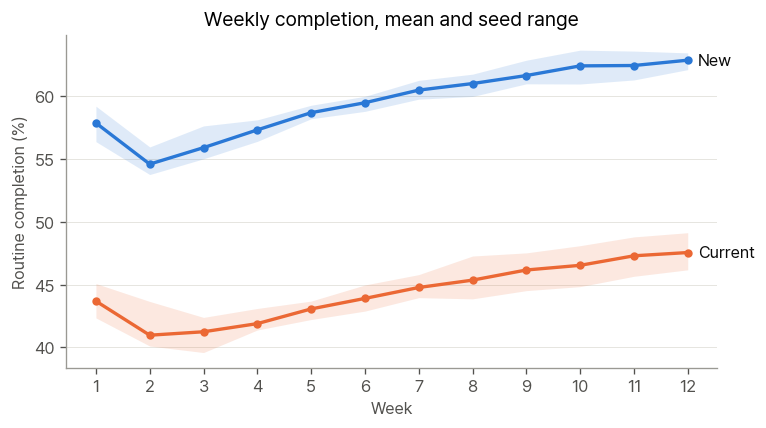
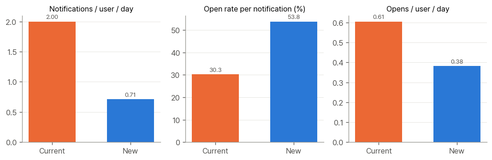

# Coaching Closed-Loop Simulation
건강 코칭 앱의 알림과 루틴 배정 방식 두 가지를 가상 사용자 300명에게 12주 동안 적용해 비교하는 폐루프 시뮬레이션입니다.

2026년 헬스커넥트에서 설계한 시뮬레이션을 합성 데이터로 다시 구현한 저장소입니다. 코드, 규칙, 숫자는 모두 이 저장소에서 새로 만들었고, 실제 사용자 데이터는 쓰지 않았습니다. **아래 결과는 모두 시뮬레이션 값이며 실제 서비스에서 측정한 효과가 아닙니다.**

## 개요

건강 코칭 앱은 사용자에게 식사, 운동, 수면, 복약 같은 하루 루틴을 배정하고 알림을 보냅니다. 이 저장소는 두 방식을 비교합니다.

| 항목 | 현행 방식 | 새 방식 |
|---|---|---|
| 알림 | 모든 사용자에게 매일 아침과 저녁 2건, 쉬는 사용자에게도 보냄 | 하루 최대 2건. 보통 1건이고, 1~2일 쉰 사용자에게만 1건을 더 보냄 |
| 알림 시각 | 고정 | 사용자가 고른 시간대에서 시작해 열람 기록으로 시간대를 고름 |
| 중단 규칙 | 없음 | 연속 4건을 열지 않으면 7일 쉬고, 다시 1건을 보내 반응을 확인 |
| 루틴 난이도 | 늘 2단계 | 1단계에서 시작해 3일 연속 완료하면 올리고, 2일 연속 놓치면 내림 |
| 쉬는 사용자 | 같은 루틴을 계속 배정 | 5일 연속 아무것도 하지 않으면 가장 자주 완료한 루틴 하나만 쉬운 난이도로 배정 |

같은 사용자와 같은 난수로 두 방식을 각각 돌리기 때문에 결과 차이는 방식 차이에서만 나옵니다. 오늘의 열람과 완료가 사용자 상태(의욕, 습관, 알림 피로)와 정책의 다음 결정을 함께 바꾸는 폐루프 구조입니다. 시뮬레이션 안에서 LLM은 부르지 않습니다.

## 주요 기능

1. **가상 사용자 생성**: 기초 의욕, 영역별 습관 강도, 시간 제약, 알림 피로 민감도, 실제로 잘 반응하는 시간대와 본인이 고른 시간대를 사용자마다 뽑습니다.
2. **폐루프 하루 진행**: 정책이 루틴과 알림을 정하면 사용자 모형이 열람과 완료를 정하고, 그 결과로 사용자 상태와 정책의 기억이 바뀝니다.
3. **보정**: 현행 방식의 12주 완료율이 합성 관측값 45%와 1%p 안에서 맞도록 사용자 모형의 절편을 이분 탐색으로 맞춥니다. 보정은 비교에 쓰지 않는 시드로 합니다.
4. **같은 사용자끼리 비교**: 사용자별 완료율 차이, 좋아진 사용자 수, 그리고 전체 차이를 사용자 안 차이와 구성 효과로 나눈 값을 냅니다.
5. **분해 실험**: 새 방식의 알림 규칙만 붙인 경우와 루틴 규칙만 붙인 경우를 따로 돌려 차이가 어디서 오는지 봅니다.
6. **대표 페르소나**: 이름 붙인 사용자 4명을 30회씩 반복 실행해 중앙값과 범위를 냅니다.

## 파일 구조

```
Coaching_ClosedLoop_Simulation/
├── config/
│   └── policies.yaml        # 정책 규칙, 사용자 모형 계수, 시드, 페르소나
├── closedloop/
│   ├── users.py             # 가상 사용자와 페르소나 생성, 두 방식이 함께 쓰는 난수
│   ├── policies.py          # 현행 방식, 새 방식, 분해 실험용 혼합 정책
│   ├── simulate.py          # 하루 단위 폐루프(정책 결정, 사용자 반응, 상태 갱신)
│   ├── calibrate.py         # 현행 방식 완료율 보정
│   ├── metrics.py           # 완료율, 알림 지표, 같은 사용자 비교와 구성 효과 분해
│   ├── report.py            # 그림과 reports/RESULTS.md 작성
│   └── run_all.py           # 보정부터 보고서까지 한 번에 실행
├── tests/
│   └── test_simulation.py   # 재현성, 보정 오차, 알림 상한, 중단 규칙 시험
├── reports/                 # 실행 결과(RESULTS.md, metrics.json, figures/)
├── requirements.txt
└── README.md
```

## 실행 방법

Python 3.11 이상에서 실행합니다.

```bash
pip install -r requirements.txt
python -m closedloop.run_all   # 보정, 두 방식 실행, reports/ 작성 (1~2초)
python -m pytest -q            # 시험 4개
```

시드가 모두 `config/policies.yaml`에 고정돼 있어서 같은 설정이면 `reports/RESULTS.md`가 바이트 단위로 같게 나옵니다.

## 시뮬레이션 설계

사용자 상태는 다섯 가지입니다. 기초 의욕은 사용자마다 정해져 있고, 그날의 의욕은 완료한 비율에 따라 오르내리다가 기초 의욕 쪽으로 돌아갑니다. 습관 강도는 루틴을 완료하면 조금씩 쌓이고 놓치면 줄어듭니다. 시간 제약은 사용자마다 정해진 값에 날마다 작은 잡음이 붙습니다. 알림 피로는 받은 알림 수만큼 쌓이고 하루마다 30%씩 빠집니다.

알림 열람 확률은 의욕이 높을수록, 사용자가 실제로 잘 반응하는 시간대에 보낼수록, 전날 무언가를 완료했을 때 올라가고, 피로가 쌓이면 내려갑니다. 루틴 완료 확률은 의욕, 습관, 영역(복약이 가장 쉽고 운동이 가장 어려움), 그날 알림을 열었는지에 따라 올라가고, 난이도와 시간 제약을 곱한 부담과 피로에 따라 내려갑니다.

정책은 사용자의 잠재 상태를 보지 못합니다. 새 방식은 보낸 알림, 열람, 배정, 완료 기록만으로 시간대, 난이도, 중단 여부를 정합니다. 모든 계수는 설계 가정이며 `config/policies.yaml`에 있습니다.

## 보정

비교하기 전에 현행 방식이 합성 관측값을 재현하는지 먼저 맞췄습니다. 보정 시드 5개(901~905)에서 사용자 모형 절편을 이분 탐색한 결과는 아래와 같습니다.

| 항목 | 값 |
|---|---|
| 목표 완료율(합성 관측값) | 45.0% |
| 보정 시드의 현행 완료율 | 45.09% (차이 +0.09%p) |
| 평가 시드 5개(11~15)의 현행 완료율 | 44.36% (차이 -0.64%p) |
| 보정한 절편 | 0.75 |

평가 시드에서도 목표와 1%p 안에 들어옵니다. 보정한 절편은 두 방식에 똑같이 씁니다.

## 결과(시뮬레이션 기준)

새 방식은 알림을 하루 2건에서 0.71건으로 줄이면서 12주 루틴 완료율을 44.4%에서 59.6%로 높였습니다. 시드 5개에서 차이는 14.1%p에서 15.8%p입니다. 다만 사용자 1명이 하루에 여는 알림 수는 0.61건에서 0.38건으로 줄었습니다. 값은 시드 평균이고 괄호는 시드별 최솟값과 최댓값입니다.

| 지표 | 현행 | 새 방식 |
|---|---|---|
| 12주 루틴 완료율 | 44.4% (43.2, 45.8) | 59.6% (58.9, 60.2) |
| 사용자 1명 하루 알림 수 | 2.00 | 0.71 (0.70, 0.72) |
| 알림 1건당 열람률 | 30.3% (29.8, 31.0) | 53.8% (53.2, 54.7) |
| 사용자 1명 하루 열람 수 | 0.61 (0.60, 0.62) | 0.38 (0.37, 0.40) |
| 사용자 1명 하루 배정 루틴 수 | 3.41 | 3.36 |
| 사용자 1명 하루 완료 루틴 수 | 1.51 | 2.00 |

영역별 완료율도 네 영역 모두 새 방식이 높습니다. 식사 47.1%와 62.3%, 운동 37.5%와 53.3%, 수면 43.9%와 59.4%, 복약 55.6%와 68.6%입니다(앞이 현행).



### 같은 사용자끼리 보면 4명 중 1명 넘게 나빠집니다

시드마다 300명 가운데 208~216명은 완료율이 올랐고 82~90명은 내렸습니다. 사용자별 차이의 평균은 +13.9%p에서 +15.2%p입니다. 차이 분포는 0 근처와 +30%p 근처에 봉우리가 둘 있습니다.

새 방식이 잘하는 사용자에게 난이도를 올리기 때문에 나빠진 사용자는 대부분 의욕이 높은 쪽에 몰려 있습니다. 아래 표는 평가 시드 5개를 합쳐 기초 의욕 구간별로 나눈 값입니다.

| 기초 의욕 | 사용자 수 | 현행 완료율 | 새 방식 완료율 | 나빠진 사용자 | 새 방식 평균 난이도 |
|---|---|---|---|---|---|
| -1 미만 | 235 | 5.9% | 21.6% | 0 | 1.05 |
| -1 이상 0 미만 | 521 | 23.1% | 51.5% | 11 | 1.56 |
| 0 이상 1 미만 | 508 | 61.6% | 70.2% | 202 | 2.30 |
| 1 이상 | 236 | 89.9% | 86.3% | 212 | 2.76 |

의욕이 가장 높은 구간은 평균 난이도 2.76의 루틴을 86.3% 완료했고, 현행에서는 난이도 2 루틴을 89.9% 완료했습니다. 완료율만 보면 나빠졌지만 더 어려운 루틴을 하고 있으므로, 완료율 하나로 두 방식을 평가하면 안 됩니다.

### 차이는 대부분 사용자 안에서 나오고 구성 효과는 1%p 미만입니다

새 방식은 쉬는 사용자에게 루틴을 하나만 배정하므로, 완료율이 낮은 사용자의 루틴이 분모에서 빠져 전체 완료율이 오르는 구성 효과가 생길 수 있습니다. 새 방식의 사용자별 완료율에 현행의 사용자별 배정 수를 가중치로 다시 매겨 전체 차이를 나눴습니다. 구성 효과는 시드마다 +0.44%p에서 +0.87%p이고, 나머지 +13.7%p에서 +15.1%p는 같은 사용자 안에서 생긴 차이입니다. 이 모형에서는 5일 연속 아무것도 하지 않는 사용자가 많지 않아 구성 효과가 작게 나왔습니다. 쉬는 사용자 비율이 높은 집단이라면 이 몫은 커집니다.

사용자 안 차이도 같은 루틴을 더 잘하게 된 몫만은 아닙니다. 새 방식의 규칙 가운데 하나씩만 현행에 붙여 돌린 결과로 두 몫을 나눴습니다.

| 방식 | 루틴 완료율 | 하루 알림 수 | 하루 열람 수 |
|---|---|---|---|
| 현행 | 44.4% | 2.00 | 0.61 |
| 새 알림 규칙만 적용 | 50.7% | 0.67 | 0.35 |
| 새 루틴 규칙만 적용 | 55.3% | 2.00 | 0.67 |
| 새 방식 | 59.6% | 0.71 | 0.38 |

루틴 규칙만으로 +10.9%p, 알림 규칙만으로 +6.3%p가 오릅니다. 루틴 규칙의 몫은 못 하는 사용자에게 쉬운 루틴을 준 데서 크게 나오므로, 이 몫을 건강 행동이 늘어난 것으로 읽으면 과장입니다. 알림 규칙만 붙였을 때는 하루 열람 수가 0.35건으로 오히려 줄었으니, 이 몫은 열람이 늘어서가 아니라 알림 피로가 줄어서 생겼습니다.

### 알림을 줄이면 총 열람 수도 줄어듭니다

알림 1건당 열람률은 30.3%에서 53.8%로 올랐지만 하루 열람 수는 0.61건에서 0.38건으로 37% 줄었습니다. 열람률이 오른 데는 시간대 학습과 함께, 열지 않는 사용자에게 보내지 않는 중단 규칙이 분모를 줄인 몫도 들어 있습니다. 알림을 덜 보내면 건당 효율은 오르고 사용자와 닿는 횟수는 줄어듭니다. 열람 수 자체가 중요한 서비스라면 이 손실을 따로 따져야 합니다.



### 대표 페르소나

30회 반복 실행의 완료율 중앙값입니다. 괄호는 최솟값과 최댓값입니다.

| 페르소나 | 특징 | 현행 | 새 방식 |
|---|---|---|---|
| busy_worker | 시간 제약이 크고 고른 시간대가 실제와 다름 | 25.0% (10.3, 39.3) | 58.7% (50.0, 63.5) |
| motivated_beginner | 의욕이 높고 시간 여유가 있음 | 86.9% (73.8, 92.9) | 82.5% (73.8, 89.7) |
| notification_sensitive | 알림 피로에 민감함 | 35.6% (19.6, 53.0) | 65.9% (60.1, 70.8) |
| drifting_away | 의욕이 낮아 이탈 위험이 큼 | 5.8% (3.3, 8.9) | 25.7% (17.9, 45.8) |

drifting_away는 새 방식에서도 하루 루틴을 3.97개 배정받아 루틴 수가 거의 줄지 않았습니다. 완료율이 오른 것은 루틴 난이도가 평균 1.06단계로 내려가고 알림 피로가 줄었기 때문입니다. 하루 열람 수는 현행 0.15건, 새 방식 0.08건으로 오히려 줄었습니다. 전체 표와 나머지 그림은 [reports/RESULTS.md](reports/RESULTS.md)에 있습니다.

## 한계

- 사용자 모형의 계수는 모두 설계 가정입니다. 차이의 크기(약 15%p)는 난이도 부담, 알림 피로 같은 계수에 크게 기대므로 실제 효과의 추정치로 쓰면 안 됩니다. 이 저장소는 차이가 어디서 나오는지 나눠 보는 방법을 보여 주려고 만들었습니다.
- 보정은 전체 완료율 하나에만 맞췄습니다. 영역별 완료율, 열람률, 이탈 비율은 관측값에 맞추지 않았습니다.
- 알림 끄기, 앱 삭제, 영구 이탈은 모형에 없습니다. 현행 방식은 쉬는 사용자에게도 하루 2건을 보내므로 실제라면 알림을 끄는 사용자가 생길 수 있습니다. 이 한계는 현행 방식에 유리하게 작용합니다.
- 난이도는 1~3단계 숫자일 뿐이고 운동 시간이나 섭취량 같은 실제 행동량과 연결하지 않았습니다. 그래서 완료율이 오른 것이 건강 행동이 늘었다는 뜻인지는 이 모형으로 말할 수 없습니다.
- 민감도 분석은 넣지 않았습니다. 계수를 바꿔 보려면 `config/policies.yaml`을 고치고 다시 실행합니다.
