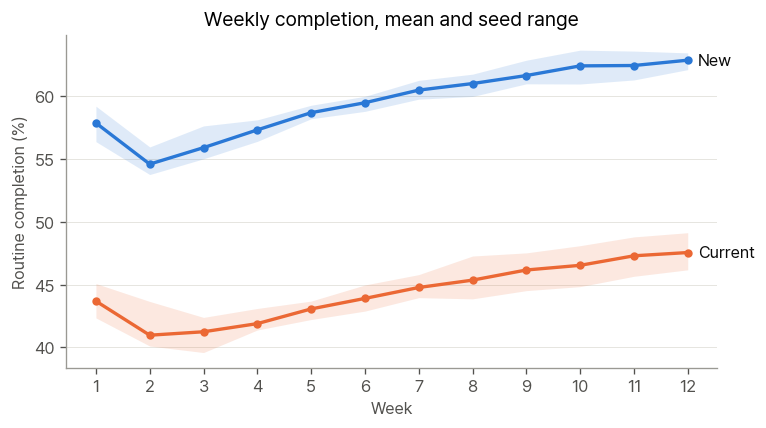
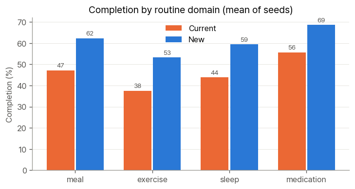
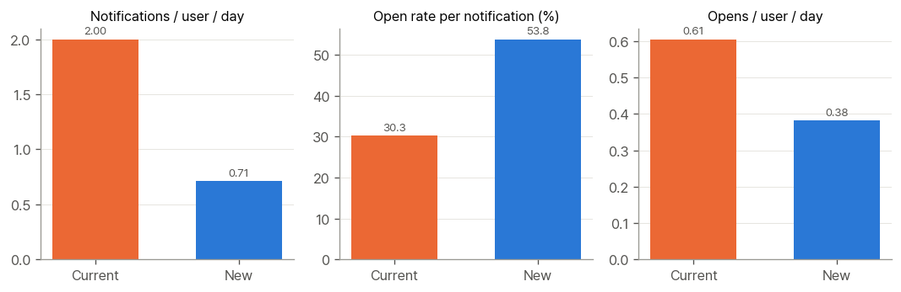
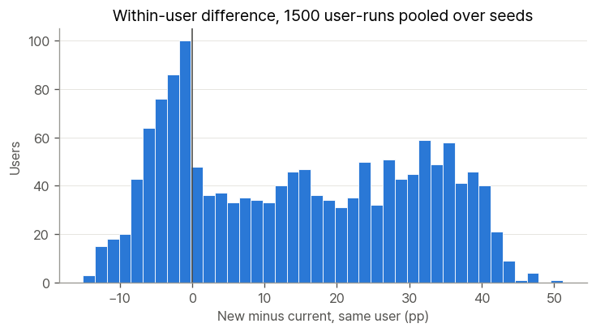

# 시뮬레이션 결과

이 문서는 `python -m closedloop.run_all`이 만듭니다. 모든 숫자는 합성 데이터로 돌린 시뮬레이션 결과이고, 실제 사용자에게서 측정한 효과가 아닙니다.

평가 시드는 11, 12, 13, 14, 15이고 시드마다 가상 사용자 300명을 12주 동안 돌립니다. 표의 값은 시드 평균이고 괄호 안은 시드별 최솟값과 최댓값입니다.

## 1. 보정

| 항목 | 값 |
|---|---|
| 목표 완료율(합성 관측값) | 45.0% |
| 보정 시드(901, 902, 903, 904, 905)의 현행 완료율 | 45.09% |
| 보정 차이 | +0.09%p (허용 범위 ±1.0%p) |
| 평가 시드의 현행 완료율 | 44.36% (목표와 -0.64%p) |
| 보정한 사용자 모형 절편(base_logit) | 0.7500 |

## 2. 집단 결과

| 지표 | 현행 | 새 방식 |
|---|---|---|
| 루틴 완료율(%) | 44.4 (43.2, 45.8) | 59.6 (58.9, 60.2) |
| 사용자 평균 완료율(%) | 44.0 (42.7, 45.3) | 58.6 (57.8, 59.5) |
| 사용자 1명 하루 알림 수 | 2.00 (2.00, 2.00) | 0.71 (0.70, 0.72) |
| 알림 1건당 열람률(%) | 30.3 (29.8, 31.0) | 53.8 (53.2, 54.7) |
| 사용자 1명 하루 열람 수 | 0.61 (0.60, 0.62) | 0.38 (0.37, 0.40) |
| 사용자 1명 하루 배정 루틴 수 | 3.41 (3.37, 3.44) | 3.36 (3.34, 3.39) |
| 사용자 1명 하루 완료 루틴 수 | 1.51 (1.48, 1.56) | 2.00 (1.98, 2.02) |
| 배정 루틴 평균 난이도(1~3) | 2.00 (2.00, 2.00) | 1.94 (1.92, 1.95) |

## 3. 영역별 완료율(%)

| 영역 | 현행 | 새 방식 |
|---|---|---|
| meal | 47.1 (45.6, 48.6) | 62.3 (61.4, 63.0) |
| exercise | 37.5 (36.4, 38.9) | 53.3 (52.6, 53.9) |
| sleep | 43.9 (42.6, 45.0) | 59.4 (58.7, 60.2) |
| medication | 55.6 (54.8, 57.8) | 68.6 (68.3, 69.2) |

## 4. 같은 사용자끼리 비교

두 방식은 같은 사용자와 같은 난수를 씁니다. 차이는 새 방식에서 현행을 뺀 값입니다. 전체 차이는 사용자 안 차이와 구성 효과의 합입니다. 구성 효과는 사용자별 배정 루틴 수가 달라져 생기는 몫입니다.

| 시드 | 사용자 평균 차이(%p) | 중앙값(%p) | 좋아진 사용자 | 나빠진 사용자 | 전체 차이(%p) | 사용자 안 차이(%p) | 구성 효과(%p) |
|---|---|---|---|---|---|---|---|
| 11 | +14.4 | +14.4 | 208/300 | 90/300 | +15.1 | +14.3 | +0.78 |
| 12 | +14.7 | +13.0 | 215/300 | 82/300 | +15.4 | +14.6 | +0.78 |
| 13 | +13.9 | +13.7 | 209/300 | 87/300 | +14.1 | +13.7 | +0.49 |
| 14 | +15.1 | +15.3 | 215/300 | 83/300 | +15.8 | +14.9 | +0.87 |
| 15 | +15.2 | +15.2 | 216/300 | 83/300 | +15.6 | +15.1 | +0.44 |

기초 의욕(motivation, 잠재 변수) 구간별로 모든 평가 시드를 합친 결과입니다.

| 기초 의욕 구간 | 사용자 수 | 현행 완료율(%) | 새 방식 완료율(%) | 나빠진 사용자 | 새 방식 평균 난이도 |
|---|---|---|---|---|---|
| -1 미만 | 235 | 5.9 | 21.6 | 0 | 1.05 |
| -1 이상 0 미만 | 521 | 23.1 | 51.5 | 11 | 1.56 |
| 0 이상 1 미만 | 508 | 61.6 | 70.2 | 202 | 2.30 |
| 1 이상 | 236 | 89.9 | 86.3 | 212 | 2.76 |

## 5. 차이를 나눠 보는 실험

새 방식의 알림 규칙과 루틴 규칙을 하나씩만 현행에 붙여 돌린 결과입니다.

| 방식 | 루틴 완료율(%) | 하루 알림 수 | 하루 열람 수 | 평균 난이도 |
|---|---|---|---|---|
| 현행 | 44.4 (43.2, 45.8) | 2.00 (2.00, 2.00) | 0.61 (0.60, 0.62) | 2.00 (2.00, 2.00) |
| 새 방식 | 59.6 (58.9, 60.2) | 0.71 (0.70, 0.72) | 0.38 (0.37, 0.40) | 1.94 (1.92, 1.95) |
| 새 알림 + 현행 루틴 | 50.7 (49.2, 52.0) | 0.67 (0.66, 0.67) | 0.35 (0.34, 0.36) | 2.00 (2.00, 2.00) |
| 새 루틴 + 현행 알림 | 55.3 (54.6, 56.2) | 2.00 (2.00, 2.00) | 0.67 (0.66, 0.68) | 1.83 (1.82, 1.85) |

## 6. 대표 페르소나(30회 반복)

완료율은 반복 실행의 중앙값이고 괄호 안은 최솟값과 최댓값입니다.

| 페르소나 | 방식 | 완료율(%) | 하루 알림 수 | 하루 열람 수 |
|---|---|---|---|---|
| busy_worker | 현행 | 25.0 (10.3, 39.3) | 2.00 | 0.51 |
| busy_worker | 새 방식 | 58.7 (50.0, 63.5) | 0.65 | 0.26 |
| motivated_beginner | 현행 | 86.9 (73.8, 92.9) | 2.00 | 1.15 |
| motivated_beginner | 새 방식 | 82.5 (73.8, 89.7) | 1.00 | 0.71 |
| notification_sensitive | 현행 | 35.6 (19.6, 53.0) | 2.00 | 0.32 |
| notification_sensitive | 새 방식 | 65.9 (60.1, 70.8) | 0.80 | 0.40 |
| drifting_away | 현행 | 5.8 (3.3, 8.9) | 2.00 | 0.15 |
| drifting_away | 새 방식 | 25.7 (17.9, 45.8) | 0.39 | 0.08 |

## 그림

